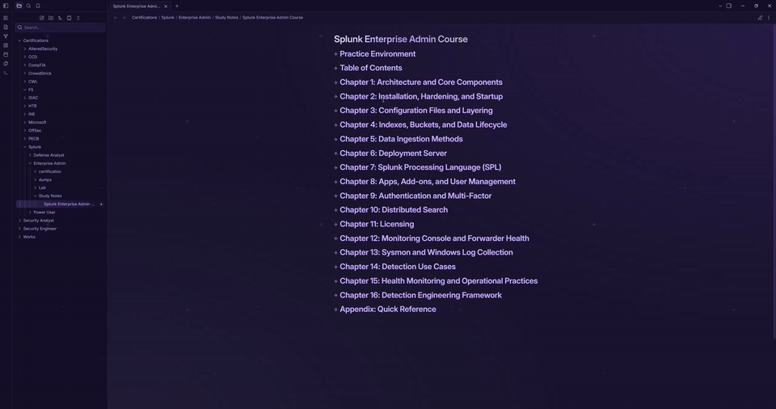

# TheWonderSpace

A calm, cosmic theme for [Obsidian](https://obsidian.md). It turns your vault into a quiet space for thinking and writing, with small details that make everyday notes feel a little more alive.



## Why "Wonder"?

The name comes from the feeling of looking up at the night sky: calm, curious, and a little amazed. TheWonderSpace aims to bring that feeling to your notes without getting in the way of the writing. Everything is subtle, nothing flashes, and every effect can be switched off.

## What makes it different

### A living sky
- **Shining stars.** A few quiet stars breathe softly in the background. Some sparkle now and then, and a shooting star passes once in a while.
- **Entrance animation.** Your vault fades and zooms in gently when it opens.
- **Reduced motion.** If your system has reduced motion turned on, every animation stays off.

### Moon-phase tasks
Checkboxes are little moons that show how far along a task is.

```
- [ ] New moon (to do)
- [/] Half moon (in progress)
- [x] Full moon (done)
- [-] Dark moon (cancelled)
- [!] Comet (important)
```

### Cosmic callouts
Four extra callout types on top of the built-in ones:

```
> [!star] Something worth remembering
> [!nebula] An idea taking shape
> [!moon] A quiet thought
> [!launch] Time to ship
```

### Star headings
- In reading view, the star in front of a heading is its fold button. A glowing star means open, and a dim, turned star means folded.
- The same style applies to fold markers in the editor.
- Top-level headings get a soft gradient and a thin underline.

### Details that make writing nicer
- **Constellation dividers.** A horizontal rule (`---`) becomes a line with a glowing star in the middle.
- **Sparkling links.** A small star pops in when you hover over a link in reading view.
- **Soft active line.** The line you are writing on has a gentle glow, and the cursor is easy to find.
- **Round tags.** Tags are pills that glow on hover.
- **Tidy tables, quotes, and inline code.** Rounded corners and clear structure.
- **Calm file explorer.** The active note is marked with a small glowing star instead of a harsh bar.
- **Starry graph view.** Notes read as stars connected into constellations.
- **Frosted glass.** Menus, popups, and the command palette are softly blurred.

## Installation

### From the community themes
1. Open **Settings → Appearance**.
2. Under **Themes**, click **Manage**.
3. Search for **TheWonderSpace** and click **Install and use**.

### Manual installation
1. Download `theme.css` and `manifest.json` from the [latest release](https://github.com/qays3/TheWonderSpace/releases/latest).
2. In your vault, create the folder `.obsidian/themes/TheWonderSpace/`.
3. Put both files inside it.
4. In Obsidian, go to **Settings → Appearance → Themes**, refresh, and select **TheWonderSpace**.

## Customization

You can change the theme with a CSS snippet in `.obsidian/snippets/`.

To turn off the stars while keeping everything else:

```css
body.theme-dark::before,
body.theme-dark::after,
body.theme-dark .app-container::before,
body.theme-dark .app-container::after {
  display: none;
}
```

To turn off the entrance animation:

```css
.app-container > .horizontal-main-container {
  animation: none;
}
```

## Good to know

- The theme works in dark and light mode. The shining stars appear in dark mode only.
- It uses the **Inter** font for text. If Inter isn't installed, it falls back to your system font.
- Works with Obsidian 1.0.0 and newer.
- Tested on desktop. Mobile feedback is welcome.

## Contributing

Found a bug or have an idea? Open an [issue](https://github.com/qays3/TheWonderSpace/issues) or a pull request. Screenshots of what looks off are very helpful.

## License

MIT